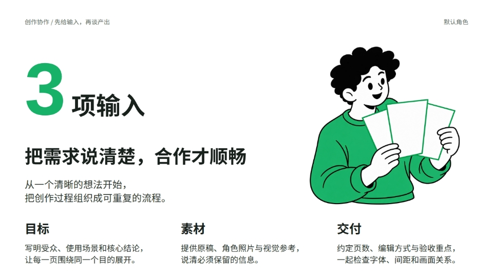

# zhouxing-IP-PPT

让角色参与内容表达，制作可以继续编辑的飞书 PPT。

支持内置插画小人、自定义卡通 IP 和真人照片。角色与场景由生图工具制作，标题、正文、数字、信息框、箭头等保持为幻灯片原生对象。默认交付飞书原生幻灯片；明确要求时可用当前 Agent 的工具输出本地 PPTX。

## 先看实际效果

### 蓝色整套案例：AI 视频入门

默认配色为钴蓝 `#1246F2`，配套母图、提示词与主题配置同步采用蓝色。下面从之前制作的16页稿中选出9页组成案例图组；只展示成品页面，没有发布原始账号界面、个人 IP 或真人照片。案例是历史实际输出，保留当时版式，并非所有页面都采用当前最新布局规则。


[查看9页大图与案例说明](docs/blue-case.md)。正文、数字、框线在制作时使用原生对象；仓库里的预览图为静态展示。

### 绿色配色示例


下面三张是此前绿色主题下实际幻灯片的渲染截图，来自内置角色样页，展示的是完成排版后的页面。README 中的图片本身是静态预览。

### 大数字与内容分组

数字参与标题阅读，角色呼应下方信息组，靠尺度、对齐和间距组织内容。



### 角色扶框与圆角模块

角色的动作与“整理资产”相关；手臂与内容框接触，原生圆角模块、编号和胶囊共同建立信息层级。


### 截图、样机与对话标注

本项目样页截图按比例铺满薄 MacBook 外框，对话框、关键词高亮和箭头引导检查重点，角色从页边进入。


这些样页展示内置 2D 插画路线；绿色是配色示例，当前无输入默认色为蓝色。自定义 IP、3D 和真人模式的效果取决于所用生图模型、参考素材与目标工具；本页未提供这几种路线的公开成品示例。

## 安装

把下面一段发给支持 Skill 安装的 Agent：

```text
请安装或更新这个 Skill：
https://github.com/Kianzzz/zhouxing-ip-ppt
完整保留 SKILL.md、references、scripts、assets 和许可文件。
默认制作可编辑的飞书 PPT，优先复用你已有的飞书工具；没有时引导我接入并授权。
安装完成后简短告诉我如何开始。
```

也可以下载或克隆本仓库，把它作为 `zhouxing-ip-ppt` 文件夹放进当前 Agent 的技能目录。入口是 [SKILL.md](SKILL.md)。安装过程中不自动创建文档或生成测试稿。

已安装合集版本时，更新原有 `zhouxing-ip-ppt` 入口，避免同名 Skill 重复安装。

## 开始使用

```text
用 zhouxing-ip-ppt，把下面的内容做成飞书 PPT。
先做 3 张有代表性的样页：主题页、信息较多页、带真实截图页。
角色使用默认模式；配色与排版按内容设计。
```

使用自己的角色时，附上角色参考图；需要界面演示时附上真实截图。可以指定页数、受众、用途、配色、参考风格，以及要先看样页还是直接做完整稿。

## 能做什么

- **按内容选布局**：大数字、图文交错、多框分组、比较、对话、设备截图；支持全身、半身、近景、局部与多人互动。
- **按主色建立配色**：优先用户指定，否则取角色最大面积彩色主色，配合同色深浅阶及中性色；无输入时用内置钴蓝 `#1246F2`。
- **设计图文关系**：为元素建立对齐对应；角色可扶框、指认、遮挡或有意出血，动作须解释本页内容。
- **保留可编辑结构**：文字、数字、形状和标注为原生元素；角色与截图可移动、缩放和替换，图片内部并非逐部位可编辑。
- **套入真实截图**：内置 iPhone 与薄屏 MacBook 外框，默认铺满，支持源裁切和标注坐标映射。
- **检查与保留修改**：回读、预览并检查字形、换行、间距、层次及裁切；修改已有稿时保留用户手动调整。

## 工具与兼容

核心设计规则适用于具备相应能力的 Agent。`agents/openai.yaml` 仅是 Codex 界面元数据，其他 Agent 可忽略。

制作时需要参考图生图能力（或已有匹配素材），以及能写原生对象、回读和预览的幻灯片工具。默认使用现有飞书工具；缺少时按 [工具适配](references/tool-adapters.md) 引导接入官方工具与授权。飞书网页端可查看编辑，桌面客户端安装不等于 Agent 已获得写入权限。

Python 检查脚本使用标准库；本地图片测量和样机合成按需使用 Node.js 与 `@napi-rs/canvas`。安装 Skill 不要求预先装齐所有备用工具；本地 PPTX 路线仅在用户需要时启用。

- [视觉系统](references/design-system.md)
- [角色与场景协议](references/character-workflow.md)
- [设备样机与裁切](references/device-mockups.md)
- [交付与验证](references/delivery.md)

## 示例与许可

示例使用本项目生成的默认角色和通用演示文案；设备中的画面也是本项目样页截图。预览未包含个人 IP、真人照片、账号或私人云文档链接。原始第三方参考 PPT 拼图未随仓库分发。

代码与文档采用 [MIT License](LICENSE)。默认插画为 AI 生成；实际使用时仍需遵守所用模型的条款。设备外框衍生自 [devices.css](https://github.com/picturepan2/devices.css)，原始版权、MIT 许可与锁定版本见 [样机目录](assets/device-mockups/)；不是 Apple 官方样机。
