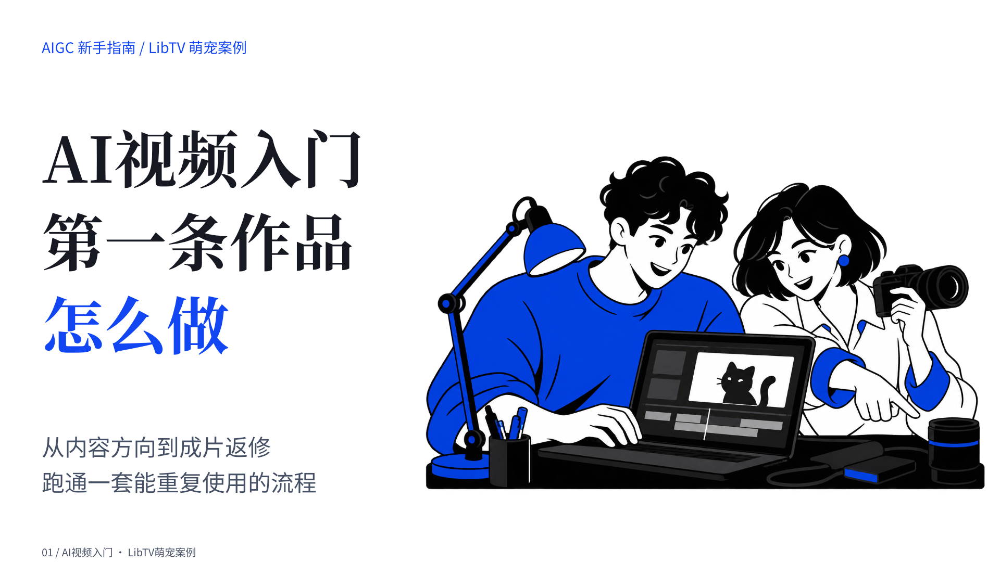
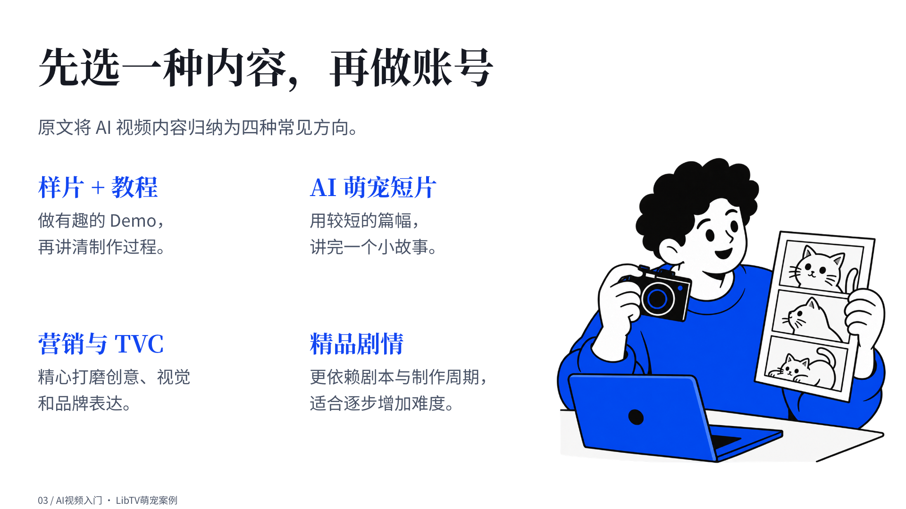
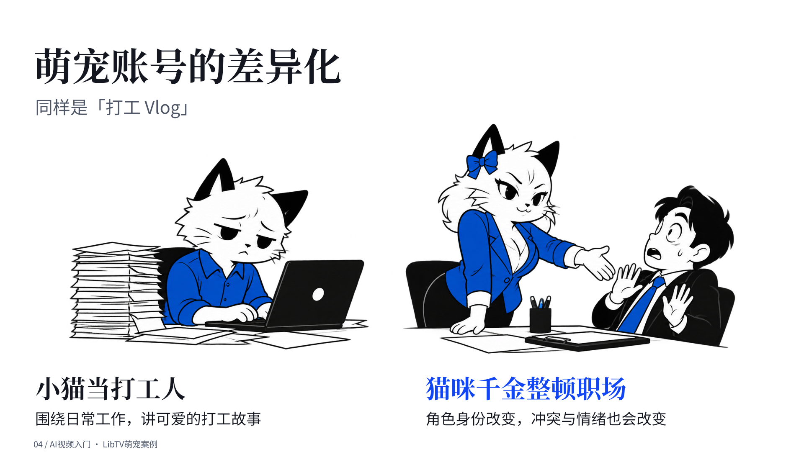
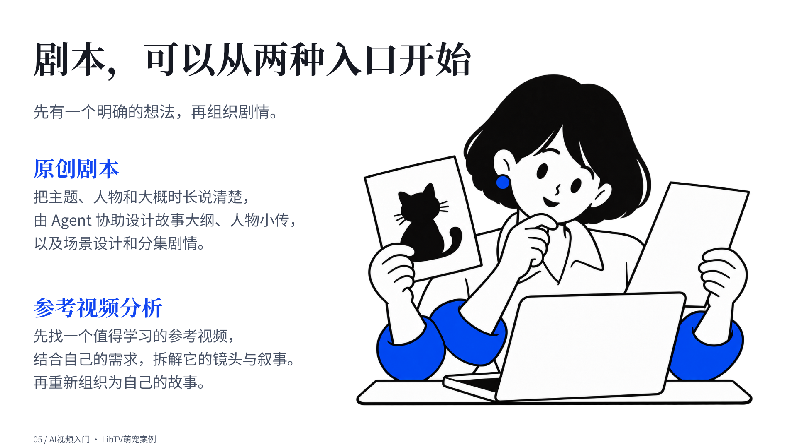
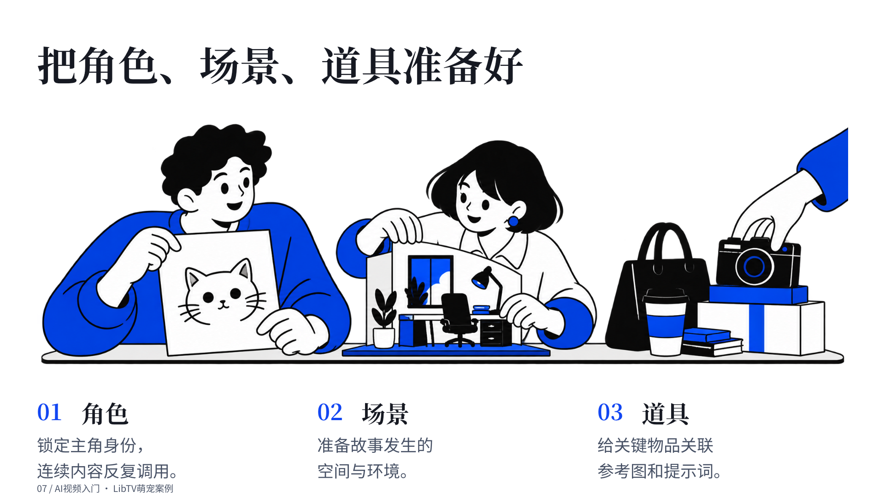
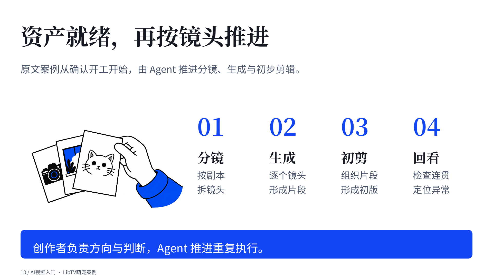
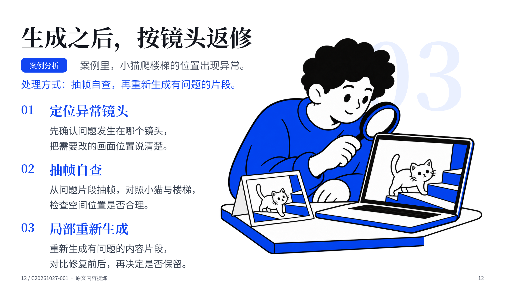
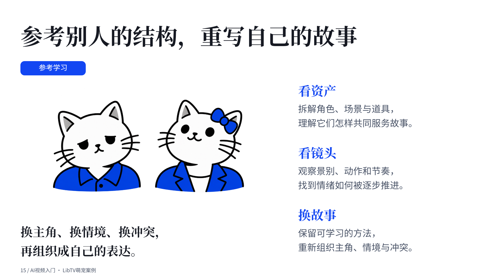
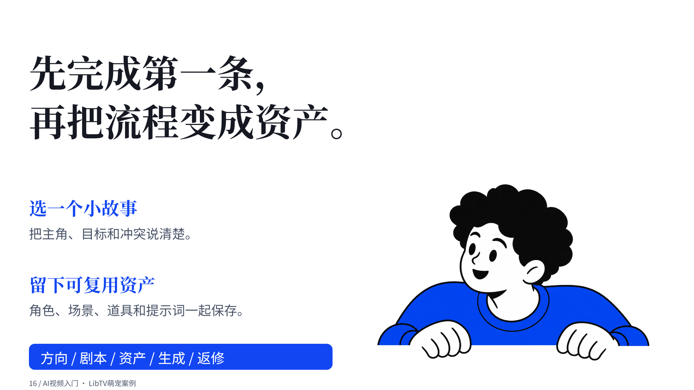

# 蓝色PPT案例：AI视频入门

本组来自此前完成的16页演示稿，选取其中9张可公开页面。截图保持原样，未为展示重绘。默认角色、场景与插画由AI生成；未收录含账号界面的操作截图。

这是既有案例，展示图文关系、景别和信息密度；不是当前每项规则的强制模板，也不保证其他 Agent 自动复现相同效果。

[返回首页](../README.md)

## 原稿第1页 · 主题引入

## 原稿第3页 · 内容方向

## 原稿第4页 · 对等角色比较

## 原稿第5页 · 剧本入口

## 原稿第7页 · 角色、场景与道具

## 原稿第10页 · 流程与手部局部

## 原稿第12页 · 返修方法与检查动作

## 原稿第15页 · 参考结构与角色变化

## 原稿第16页 · 收束与角色扶沿

